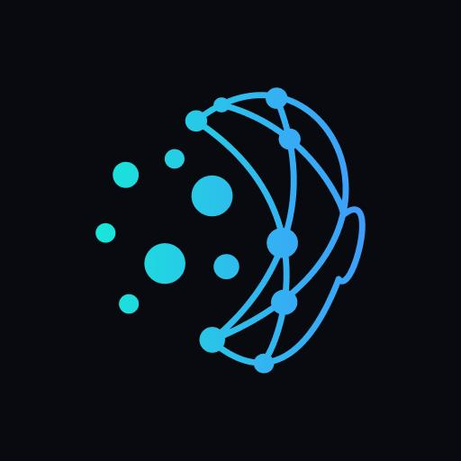

# DataPilot AI — Autonomous Data Analyst Agent (v2.0)

<p align="center">
  
</p>

[](https://www.python.org/)
[](https://streamlit.io/)
[](https://github.com/langchain-ai/langgraph)
[](https://groq.com/)
[](https://cloud.google.com/)
[](LICENSE)

**DataPilot AI** is a premium, enterprise-grade AI Data Analyst SaaS platform. Built with **Streamlit, Pandas, LangGraph, Groq, Plotly, Scikit-learn, and ReportLab**, it delivers a **ChatGPT-like conversational experience** paired with deterministic mathematical calculations, multi-turn follow-up reasoning, data transformations, interactive Plotly visualizations, time-series forecasting, executive PDF intelligence reports, and **enterprise Google OAuth 2.0 authentication**.

---

## 🎨 Master Design System — Blue & White Theme

The application strictly implements the curated **Blue and White SaaS Palette**:
- **Primary Blue**: `#2563EB`
- **Primary Hover**: `#1D4ED8`
- **Dark Blue**: `#1E40AF`
- **Sidebar Background**: `#0B2545` (Dark Navy)
- **Sidebar Secondary Navy**: `#102F55`
- **Sidebar Divider**: `#315477`
- **Light Blue**: `#DBEAFE`
- **Pale Blue**: `#EFF6FF`
- **Main Background**: `#FFFFFF`
- **Secondary Background**: `#F8FAFC`
- **Primary Text**: `#111827`
- **Secondary Text**: `#475569`
- **Border**: `#E2E8F0`
- **Success**: `#16A34A`
- **Success Background**: `#DCFCE7`
- **Warning**: `#D97706`
- **Error**: `#DC2626`

---

## 🔐 Google OAuth 2.0 & Authenticated User Profiles

DataPilot AI integrates production-grade **Google OAuth 2.0 / OpenID Connect (OIDC)** authentication with strict user session isolation.

### 1. Visual Sidebar Account Component
- **Logged Out State**: A compact, professional section at the bottom of the sidebar featuring a subtle divider (`#315477`), official 4-color Google G logo, a clean `"Continue with Google"` button, and secondary caption `"Sign in to your workspace"`.
- **Logged In State**: Displays the user's authentic Google profile photo (or high-contrast initials badge), verified Google display name, email, Google Verified indicator badge, and a menu toggle.
- **Account Dropdown**: Provides quick navigation to **Profile & Settings** and an instant **Sign Out** button that wipes active datasets, in-memory chats, and caches.

### 2. Google Cloud Console Setup Guide
To enable live Google OAuth in your environment:
1. Navigate to the [Google Cloud Console](https://console.cloud.google.com/).
2. Create a new Google Cloud project (or select an existing one).
3. Go to **APIs & Services > OAuth consent screen**:
   - User Type: **External** (or Internal for Workspace organizations).
   - App Name: `DataPilot AI`.
   - Scopes: Select `.../auth/userinfo.email`, `.../auth/userinfo.profile`, and `openid`.
4. Go to **APIs & Services > Credentials**:
   - Click **Create Credentials > OAuth client ID**.
   - Application type: **Web application**.
   - Authorized JavaScript origins: `http://localhost:8501` (and your production domain).
   - Authorized redirect URIs: `http://localhost:8501` (and `https://your-domain.com`).
5. Copy your **Client ID** and **Client Secret**.

### 3. Configuring Secrets
Create `.streamlit/secrets.toml` from `.streamlit/secrets.toml.example`:
```toml
# .streamlit/secrets.toml
[google_oauth]
client_id = "YOUR_GOOGLE_CLIENT_ID.apps.googleusercontent.com"
client_secret = "GOCSPX-your_google_client_secret"
redirect_uri = "http://localhost:8501"

[groq]
api_key = "gsk_your_groq_api_key_here"
```
Or set system environment variables:
```powershell
$env:GOOGLE_CLIENT_ID="YOUR_GOOGLE_CLIENT_ID.apps.googleusercontent.com"
$env:GOOGLE_CLIENT_SECRET="GOCSPX-your_google_client_secret"
$env:GOOGLE_REDIRECT_URI="http://localhost:8501"
```

*Note: If OAuth credentials are not yet configured, an informative Administrator Setup Guide popover is displayed with an optional 1-click Sandbox Demo profile for local evaluation.*

---

## 🧭 Application Navigation (8 Pages)

1. **🏠 Home**: Executive launchpad, quick-action cards, drag-and-drop CSV & Excel uploader, sample dataset loaders, KPI health indicators, proactive discoveries ticker, and suggested question chips.
2. **📁 Data Workspace**: File ingestion, multi-sheet Excel selector, schema inspection, dtypes table, summary statistics, and data quality distribution.
3. **💬 Ask AI**: ChatGPT-style conversational assistant with true token-by-token streaming, deterministic Python tool execution, multi-turn memory (resolves "it", "compare with last year", "show a chart of it"), formula pills, Plotly chart attachments, expandable data tables, and 1-click copy & retry actions.
4. **📊 Visualization Studio**: Interactive Plotly studio with manual configuration (Bar, Line, Area, Pie, Donut, Scatter, Box, Heatmap) and AI natural language chart generator, styled with the Blue SaaS colorway.
5. **🧪 Data Lab**: Deterministic data cleaning, deduplication, missing value treatment, type conversion, sort/filter, group/aggregate, safe derived column engineering (AST evaluator), pivot tables, visual outlier inspector & trimmer, and audit trail with 1-click undo/reset.
6. **🔮 Prediction & Insights**: Autoregressive time-series forecasting with 95% confidence intervals, leakage-free regression (Random Forest, Gradient Boosting, Linear) and classification models with interactive "What-If" scenario simulators.
7. **📑 Reports & History**: ReportLab executive PDF report generator, tabular file exports (CSV, XLSX, JSON), stored conversation history, and strategic evidence-based recommendations.
8. **⚙️ Settings & About**: Masked Groq API configuration, live connection latency test, model architecture selector, active color palette preview, system diagnostics, and architecture guides.

---

## 🏗️ Project Architecture

```
Autonomous Data Analyst Agent/
├── .streamlit/
│   ├── config.toml           # Streamlit theme (Blue & White palette)
│   └── secrets.toml.example  # Secrets placeholder template (OAuth & Groq)
├── assets/
│   └── logo.png              # Futuristic neural head brand logo
├── src/
│   ├── auth/                 # Google OAuth 2.0 & OpenID Connect engine
│   │   ├── __init__.py
│   │   └── google_auth.py    # OIDC verification, CSRF validation, user session
│   ├── config.py             # Centralized color tokens, constants, models
│   ├── data/
│   │   ├── loader.py         # CSV & multi-sheet Excel loader
│   │   ├── profiler.py       # Deterministic dataset profiler
│   │   ├── cleaner.py        # Safe cleaning, AST formula evaluator, pivot, undo & audit
│   │   └── exporter.py       # CSV, Excel XLSX, and JSON converters
│   ├── tools/
│   │   ├── calculator.py     # Metrics, aggregations, growth rates, profit margin, outliers
│   │   ├── visualizer.py     # Plotly chart builder with Blue SaaS palette
│   │   ├── predictor.py      # Scikit-learn regression, classification & forecasting
│   │   └── recommender.py    # Evidence-based recommendation engine
│   ├── agent/
│   │   ├── llm.py            # Groq API client with true token-by-token streaming
│   │   ├── prompts.py        # System instructions & conversational context rules
│   │   ├── tools_registry.py # Pydantic-validated tool dispatching & column resolution
│   │   └── graph.py          # LangGraph state machine & streaming generator
│   ├── reports/
│   │   └── pdf_generator.py  # ReportLab executive PDF report generator
│   └── ui/
│       ├── styles.py         # Blue & White SaaS master CSS tokens & dark navy sidebar
│       └── components.py     # Header banners, KPI cards, prompt cards
├── samples/
│   ├── sales_data.csv        # 1,000+ row sales & profitability dataset
│   ├── customer_churn.csv    # 1,200 row customer churn classification dataset
│   └── student_performance.xlsx # 3-sheet academic performance Excel workbook
├── tests/
│   ├── test_google_auth.py   # Google OAuth, token verification & session isolation tests
│   ├── test_loader.py        # File loader tests
│   ├── test_profiler.py      # Profiler & narrative tests
│   ├── test_cleaner.py       # Cleaning, AST formula, undo & audit tests
│   ├── test_exporter.py      # File format export tests
│   ├── test_calculator.py    # Math & aggregation tests
│   ├── test_visualizer.py    # Plotly visualization tests
│   ├── test_predictor.py     # ML & time-series forecast tests
│   ├── test_recommender.py   # Recommendation & PDF report tests
│   ├── test_agent.py         # LangGraph agent routing tests
│   ├── test_interactive_features.py # Gauge, outlier trimmer & simulator tests
│   └── test_streaming_and_context.py # Streaming, context memory & security tests
├── app.py                    # Main Streamlit application
├── requirements.txt          # Python dependencies
├── .env.example              # Sample environment variables
├── .gitignore                # Git exclusion rules (secrets & caches protected)
└── README.md
```

---

## 🚀 Getting Started

### 1. Installation
Install the project dependencies using Python 3.12+:
```powershell
python -m pip install -r requirements.txt
```

### 2. Groq API Key (Pre-Configured & Built-In)
DataPilot AI comes with a **built-in Groq API key** pre-configured out-of-the-box for instant access to conversational reasoning, LangGraph orchestration, and streaming intelligence. 

*(Optional)* If you wish to use your own custom Groq API key:
1. Set the environment variable:
   ```powershell
   $env:GROQ_API_KEY="gsk_your_custom_key_here"
   ```
2. Or configure it directly in `.streamlit/secrets.toml` or the **Settings / About** page.

### 3. Launch the Web Application
```powershell
python -m streamlit run app.py
```
Open [http://localhost:8501](http://localhost:8501) in your browser.

---

## 🧪 Automated Testing

Run the full automated test suite:
```powershell
python -m pytest tests/
```

Run specific test modules:
```powershell
# Test Google OAuth authentication & session isolation
python -m pytest tests/test_google_auth.py

# Test streaming generator & multi-turn memory
python -m pytest tests/test_streaming_and_context.py

# Test LangGraph agent routing & Pydantic validation
python -m pytest tests/test_agent.py

# Test math calculator & safe transformations
python -m pytest tests/test_calculator.py tests/test_cleaner.py

# Test predictive modeling & visualizations
python -m pytest tests/test_predictor.py tests/test_visualizer.py
```

---

## 🛡️ Enterprise Security & Privacy Guarantees

- **Zero Arbitrary Code Execution**: `eval()` and `exec()` are strictly prohibited. User formulas are safely evaluated using Python's `ast` module with whitelist-only operators.
- **Cryptographic Token Verification**: Real Google ID tokens are verified using `google.oauth2.id_token.verify_oauth2_token` with audience and expiry checking.
- **Pydantic Validation**: Tool arguments and coordinator outputs are strictly validated via Pydantic schemas.
- **Session & Identity Isolation**: Datasets, transformations, conversations, and user tokens are strictly isolated per session in memory and wiped immediately on logout.
- **Secret Protection**: API keys and OAuth secrets are masked, never exposed in client logs or committed to Git, and excluded by `.gitignore`.

---

## 📄 License
This project is open-source under the MIT License.
